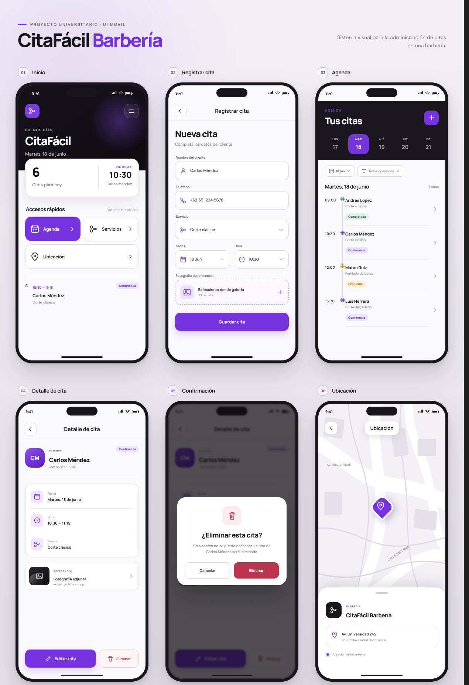

# CitaFacil-Barberia
Aplicación móvil Android para la administración de citas y servicios de una barbería
# CitaFácil - Sistema de administración de citas para barberías

## Descripción del proyecto

CitaFácil es una aplicación móvil Android orientada a facilitar la administración de citas en barberías. Está diseñada para que el encargado del establecimiento pueda organizar las citas de sus clientes, administrar los servicios disponibles y mantener un mejor control de los horarios de atención.

La aplicación permitirá registrar, consultar, modificar y eliminar citas, así como visualizar la agenda mediante filtros personalizados. También contará con opciones para adjuntar fotografías de referencia de los cortes y consultar la ubicación del establecimiento mediante un mapa.

## Objetivo general

Desarrollar una aplicación móvil Android que facilite la administración y organización de citas en barberías mediante herramientas para gestionar clientes, servicios y horarios de atención.

## Usuario principal

Encargado o administrador de una barbería.

## Funcionalidades principales

1. **CRUD de citas:** registrar, consultar, modificar y eliminar citas de clientes.
2. **Lista con filtros personalizados:** visualizar y filtrar las citas por fecha, cliente, servicio y estado.
3. **Acceso a cámara o galería:** adjuntar fotografías de referencia de los cortes solicitados.
4. **Dialog:** mostrar ventanas de confirmación para acciones como eliminar o cancelar citas.
5. **Mapa:** visualizar la ubicación del establecimiento.

## Pantallas propuestas

1. Inicio.
2. Registro de citas.
3. Agenda de citas.
4. Detalle y edición de citas.
5. Diálogo de confirmación.
6. Ubicación de la barbería.

## Mockups

En esta sección se incluirán los diseños visuales de las pantallas propuestas para la aplicación, considerando buenas prácticas de experiencia de usuario (UX).

## Tecnologías

- Android Studio.
- Kotlin.
- Git y GitHub.

La implementación se realizará utilizando los conocimientos y herramientas estudiados durante el curso.

## Organización del proyecto

El desarrollo se realizará progresivamente, incorporando las funcionalidades según las asignaciones semanales del curso.

Los avances se entregarán mediante Pull Requests hacia la rama principal del repositorio.

## Autor

Proyecto individual desarrollado como parte del curso de Desarrollo de Aplicaciones para Dispositivos Móviles.
## Mockups de la aplicación

A continuación, se presentan los diseños preliminares de las seis pantallas propuestas para CitaFácil. Los mockups consideran principios de experiencia de usuario (UX), buscando una interfaz sencilla, organizada y fácil de utilizar para el encargado de la barbería.

### Pantallas diseñadas

1. Inicio.
2. Registro de citas.
3. Agenda de citas con filtros.
4. Detalle y edición de citas.
5. Diálogo de confirmación.
6. Ubicación de la barbería.

#################################################
> Nota: La dirección y ubicación mostradas en el mockup son ilustrativas. La ubicación real se definirá durante el desarrollo.
